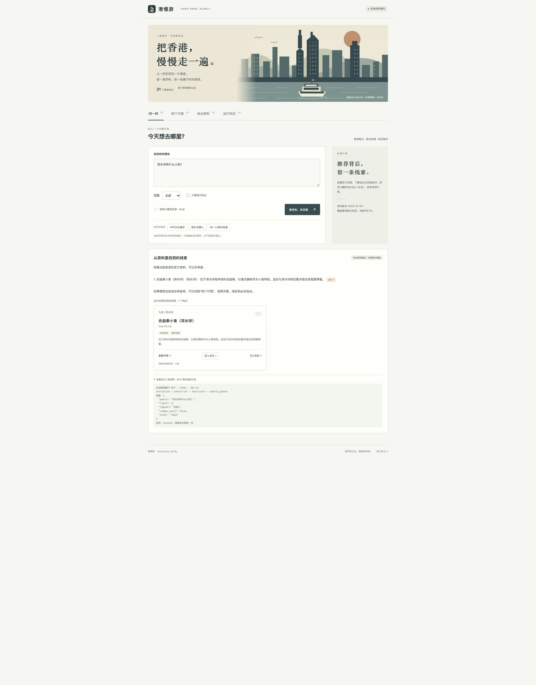

# 港慢游 · Hong Kong, slowly

一个可本地运行、便于学习的香港旅行助手。Python 后端、原生 HTML/CSS/JavaScript 页面，无需前端构建。当前提供 21 条有官方出处的景点与餐饮资料。

版本 **1.1.0** 提供本地演示。当前实测为 macOS arm64 / Python 3.14.7，105 项 Python 检查与 5 项前端缓存检查通过，真实模型和高德仍待联调。详细证据见 [本地开发测试报告](docs/本地开发测试报告.md)。

## 先运行起来

需要 Python 3.11+。**没有任何 API Key 也可以运行。**

- macOS：双击本目录的 `启动港慢游.command`。第一次会联网安装依赖，之后直接启动。
- Windows：安装 Python 3.11+ 后双击 `启动港慢游.bat`。
- 也可以在本目录执行：

```sh
python3 start.py
```

页面地址是 <http://127.0.0.1:8765>，保留终端窗口，按 Ctrl+C 停止。若 macOS 提示脚本不可执行，在项目目录运行 `chmod +x 启动港慢游.command`。该项目仅绑定本机地址，不需要云服务器。

手动安装方式：

```sh
python3 -m venv .venv
source .venv/bin/activate
python -m pip install -r requirements-lock.txt
python run.py
```

Windows 激活命令为 `.venv\Scripts\activate`。端口冲突可使用 `python run.py --port 8766`。


## 界面与测试证据



[两天行程截图](docs/evidence/browser/itinerary.png) · [实际导出的行程](docs/evidence/browser/exported-plan.txt)

## 能演示什么

| 功能 | 当前行为 |
| --- | --- |
| 地点问答 | 中文关键词与英文名字检索；展示资料摘录、匹配原因和出处 |
| 行程规划 | 1–3 天；地区、兴趣、节奏、室内、公共空间、最多 3 个必去点 |
| 结果展示 | 每天的停留与转场草案、方位示意图、地点详情、官方链接 |
| 导出与恢复 | 下载 UTF-8 文本行程；浏览器自动保留最近一次成功行程，可清除 |
| 本地 MCP | 应用启动真实子进程，完成 initialize → tools/list → tools/call |
| 可选模型 RAG | 检索资料 → 将片段交给模型 → 校验引用编号；失败退回摘录 |
| 可选高德 MCP | 官方 Streamable HTTP 连接、发现工具、只读地点搜索、失败提示 |

**没有密钥时：本地检索与 MCP 是真实运行；回答为资料摘录，交通为估算。没有调用大模型或高德，不能把它们写成已验证的真实服务。**

## 三分钟演示顺序

1. “问一问”点击“雨天去哪儿”，查看室内场馆和引用。
2. 点击出处，查看地点详情与官方来源；把一个地点加入必去。
3. “排个行程”选择 2 天、兴趣和地区，生成行程，查看方位示意与停留时间。
4. 下载行程；展开下方工具调用记录，展示实际 MCP 调用名称与耗时。
5. 同时勾选室内与公共空间，观察资料不足时的明确提示，再取消限制重新生成。
6. “运行状态”展示哪些能力已接通，哪些仍需 Key。不要将失败的真实接口冒充成功。

## 之后接真实模型与高德

复制 `.env.example` 为 `.env`，只在本机填写，然后重启应用。

```dotenv
MODEL_API_KEY=你的模型服务密钥
MODEL_BASE_URL=https://api.deepseek.com/v1
MODEL_NAME=deepseek-flash
AMAP_API_KEY=你的高德Web服务密钥
```

模型适配器使用 HTTPS 的 `/chat/completions` 接口和 JSON 输出。不同供应商未必兼容相同参数；模型名以自己的服务控制台为准。配置后需要在问答页主动勾选“使用大模型回答”。**真实问答将把问题和检索片段发送给你配置的模型服务。** 程序不会把 Key 返回浏览器，不保存问答历史。

高德 Key 配置后，在地点详情点击“高德查询”。客户端先读取真实工具列表及参数结构，再调用 `maps_text_search`。如果工具结构变化、香港覆盖不足、Key 不可用或网络超时，会显示相应状态，不会返回虚构的地点。当前只实现**地点搜索**；并未接入高德的真实路线规划。页面的交通估算不会因填写 Key 自动变成高德导航。

**截至本次交付，未使用真实模型或高德密钥进行外部联调；相关适配器只经过本地协议／响应测试。**

## 项目结构与学习顺序

```text
app.py                 网页与 HTTP 接口，校验用户输入
run.py                 本机服务入口
start.py               首次安装依赖与启动
travel/
  knowledge.py         读取资料；名字匹配、中文二字片段与 BM25 排序
  planner.py           条件筛选、街区分组、兴趣评分、顺序与时间草案
  mcp_server.py        将检索／详情／估算／规划发布成 4 个 MCP 工具
  mcp_client.py        实际调用本地工具；可选连接高德远程服务
  answers.py           本地摘录；可选检索增强生成与引用检查
  config.py            从 .env 读取配置
data/places.json       21 条人工概述资料与来源、规划标签
data/eval_cases.json   小型手写检索检查集
static/                页面、样式、交互、原创 SVG 插画
tests/                 检索、约束、协议、接口、失败回退检查
docs/                  通俗讲解、资料规则、测试说明
```

建议从 `data/places.json` → `knowledge.py` → `mcp_server.py` → `mcp_client.py` → `app.py` 阅读。界面只负责收集输入、展示服务器结果。具体的逐步解释见 [学习路线](docs/学习路线.md)。

## 测试与复核

```sh
python -m pip install -r requirements-lock.txt
python -m pytest -q
python scripts/evaluate.py
```

如果装有 Node.js（只用于前端检查，不影响 Python 应用启动），还可以运行 `node --test tests/plan-storage.test.mjs`。一键回归使用 `python scripts/verify.py`，证据保存在 `docs/evidence/latest/`；Node 不在 PATH 时传入 `--node /绝对路径/node`。脚本不运行真实模型和高德，也不会覆盖已冻结的保留集首次结果。

本机诊断使用 `python scripts/doctor.py --mcp`。它检查资料、依赖和真实本地工具通信，只报告是否配置 Key，不显示 Key，也不连接外部服务。

## 资料维护与草案恢复

修改资料前先复制完整 `data/places.json` 为候选文件，保留来源与核对日，然后运行：

```sh
python scripts/manage_data.py data/places.candidate.json --stage work/places.reviewed.json
```

工具校验唯一编号、字段类型、地区与街区对应、标签、坐标范围、日期和官方来源域名。校验只说明格式可用，仍需人工阅读来源。工具只生成新审核副本，拒绝覆盖活动资料和已有输出。确认内容后再在 Git 中替换活动文件并更新资料版本，重启应用即可加载；不新增资料时无需执行上述命令。

浏览器只恢复与当前资料版本一致的有效草案，格式损坏或地点已删除时忽略旧草案。1.0 的旧缓存不会自动迁移。禁用浏览器存储时仍能生成、下载当前行程。涉及票价、营业、天气等动态信息时，关键词保护会直接显示资料边界，即使配置模型也不会把这些问题发给模型；关键词识别不能覆盖所有表达方式。

测试覆盖检索例题、规划条件组合、真实本地 MCP 子进程、HTTP 接口与错误返回，以及模型响应和远程 MCP 的本地测试服务。手写例题是开发自测，不能当作独立评测或真实用户准确率。

## 数据和能力边界

地点文字由官方资料概述而来；不分发原网页正文或照片。链接、日期和人工假设见 [数据说明](docs/数据说明.md)。坐标是人工近似 WGS84 示意点，不可用作导航或直接传给高德当作已核实的 GCJ-02 坐标。示意图的虚线仅表示顺序。

行程没有读取营业日历、实时天气或票价，没有做酒店往返、完整餐食预算、订位订票或最优路线求解。暂不支持连续对话理解、上传文档、联网自动爬取、用户账户、生产部署和任意外部 MCP 工具。推荐仅限 21 条已收录资料，资料不足会提示而不是补造。

## 实现参考与归属

本项目为本次需求新编写的教学实现，没有复制完整第三方旅游应用或让外部项目冒充本人经历。参考的是通用流程和官方 SDK 使用方式：

- [MCP Python SDK v1 文档](https://github.com/modelcontextprotocol/python-sdk/tree/v1.x)：本项目固定 SDK 1.30.0，避免与 v2 API 混用。
- [高德官方 MCP 快速接入](https://lbs.amap.com/api/mcp-server/gettingstarted)：使用当前 Streamable HTTP 地址。
- [DeepSeek Chat Completions 文档](https://api-docs.deepseek.com/api/create-chat-completion/)：可选模型接口格式。
- [Microsoft LangChain beginners](https://github.com/microsoft/langchain-for-beginners)：检索后再组织回答的学习参考；本项目没有使用其 Azure 示例配置或源码。
- [HelloAgents 旅游规划示例](https://github.com/datawhalechina/hello-agents/tree/main/code/chapter13/helloagents-trip-planner)：了解旅游工具接入思路；本项目没有复制其前后端源码。

本项目在 Codex 辅助下开发。当前验证覆盖本地检索、规划、网页交互与 MCP 通信；真实模型、高德与生产部署仍待验证。
